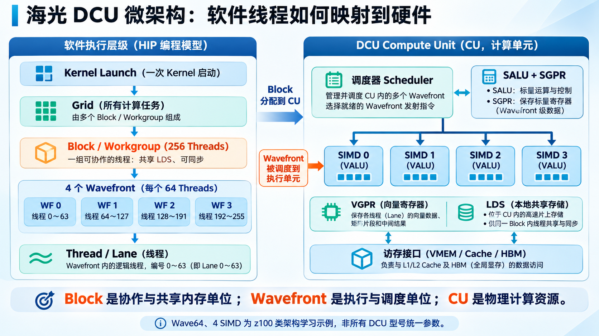

<script setup>
import MicroarchDiagram from "../.vitepress/theme/MicroarchDiagram.vue"
</script>

# 1.1 · 从 Kernel 启动到 CU

CPU 启动一个 Kernel 后，DCU 会把这次计算的 Block 分派到计算单元（CU）执行。本章用一次向量加法说明任务是怎么拆分和分派的。

## 基础概念 · 软件模型与硬件资源

理解 DCU 微架构，首先要区分两个概念：

- **软件执行模型：** 程序员如何组织线程、划分计算任务。
- **硬件执行架构：** GPU 如何分配计算资源、调度线程、执行指令和搬运数据。

二者相互关联，但不是简单的一一对应关系。

### 1.1 软件执行模型



在 HIP 编程中，一次 Kernel 启动会形成一个 Grid，Grid 包含多个 Block（Workgroup），每个 Block 内包含多个 Thread（Work-item）。

以 Wavefront Size 为 64、Block Size 为 256 为例：

```text
Kernel Launch
│
└── Grid
    │
    ├── Block 0（256 Threads）
    │   ├── Wavefront 0（Thread 0～63）
    │   ├── Wavefront 1（Thread 64～127）
    │   ├── Wavefront 2（Thread 128～191）
    │   └── Wavefront 3（Thread 192～255）
    │
    ├── Block 1（256 Threads）
    │   └── 4 个 Wavefront
    │
    └── Block N
        └── 4 个 Wavefront
```

各层级的职责如下：

| 概念 | 主要作用 | 与硬件的关系 |
|---|---|---|
| Grid | 组织一次 Kernel 的全部计算任务 | 分布到整张 GPU 的多个 CU |
| Block / Workgroup | 组织可以共享数据并同步的线程 | 一个 Block 被分配到一个 CU |
| Wavefront | 一组共享指令执行流的线程 | GPU 的重要调度与执行单位 |
| Thread / Work-item | 负责具体数据元素的计算 | 对应 Wavefront 中的逻辑 Lane |
| Lane | Thread 在当前 Wavefront 内的位置 | 用于指令执行、数据布局及跨 Lane 通信 |

需要注意，Grid、Block、Wavefront、Thread 是描述程序执行的概念，并不是四种独立的物理计算单元。

## 主线案例 · 1000 个元素的向量加法

本部分始终跟着 `C[i] = A[i] + B[i]` 走一遍。Host 提交一次 Kernel。我们设 `N=1000`、每 Block 256 个线程，使用 BW100 的 Wave64 举例。

```cpp
const int i = blockIdx.x * blockDim.x + threadIdx.x;
if (i < count) {
    c[i] = a[i] + b[i];
}
```

<MicroarchDiagram kind="mapping" />

按一维索引展开，Block 3 对应 `i=768–1023`，前三个 wave 负责 192 个完整元素，最后一个 wave 覆盖 `960–1023`。其中 40 个元素在范围内，剩下 24 个线程走边界检查，任何一个 Block 分到哪个 CU、何时运行都由设备决定。即使 BW100 有 64 个 CU，本例也只提交了 4 个 Block。

## 一次 launch 怎么结束

1. **提交**　Host 端 HIP Runtime 接到 launch 配置和参数。普通 launch 可以异步返回给 Host。
2. **分发**　设备把就绪的 Block 分配到有足够资源的 CU。同一 Block 的 wave 在同一个 CU 上执行。
3. **执行**　CU 调度器选择就绪 wave 发射指令。每个有效线程读取 A 和 B，计算后写入 C。
4. **完成**　一个 Block 做完后释放驻留资源。全部 Block 完成，Host 可以通过同步或事件观察任务结束。

这里用的是通用 HIP 编程模型，Wave64 和设备参数以 [BW100 实测基线](../baselines/bw100-gfx936.md) 为例。z100 的功能结构与 HSA 软件栈在下方进阶阅读。通用层级也可参照 [HIP 编程模型](https://rocm.docs.amd.com/projects/HIP/en/docs-6.3.0/understand/programming_model.html)。

## 动手运行

在仓库根目录运行。换卡时通过设备属性确认编译目标和 wave size。

```bash
cd experiments
hipcc -O3 -std=c++17 --offload-arch=gfx936 -save-temps vector_add_tutorial.hip -o tutorial_add
./tutorial_add
```

已在 BW100 实机确认 **1000 个有效输出正确，24 个边界位置保持原值**。`-save-temps` 同时导出设备端 ISA，[第 1.3 章](../03-memory/memory-hierarchy.md#跟一条加载指令)会用其中的加载和等待片段。

::: details 查看完整 HIP 示例

<<< ../../experiments/vector_add_tutorial.hip{cpp}

:::

::: details 复述题 · 把每个 Block 改成 128 个线程会怎样？

仍以 Wave64 为例。Grid 变成 8 个 Block，每个 Block 2 个 wave。最后一个 Block 有 104 个有效线程，最后一个 wave 仍有 40 个有效元素。这里不预设 CU 的分配顺序。

:::

[继续 1.2 · 看一个 wave 怎么执行](../02-compute/cu-and-simt.md)

## 进阶阅读

::: details 查看 z100 参考组织与软件栈

### 1.2 DCU 的物理硬件组织

以早期 z100 类微架构为例，可以建立如下整体认知：

```text
DCU GPU
│
├── 命令处理与任务分发
│   ├── 接收 Kernel Dispatch
│   ├── 管理计算任务
│   └── 将 Workgroup 分配给 CU
│
├── Compute Unit 0
│   │
│   ├── 调度与控制单元
│   │   ├── Wavefront Scheduler
│   │   ├── 指令发射与依赖管理
│   │   └── 分支与执行掩码控制
│   │
│   ├── Scalar 执行资源
│   │   ├── SALU
│   │   └── SGPR
│   │
│   ├── Vector 执行资源
│   │   ├── SIMD 0 + VGPR
│   │   ├── SIMD 1 + VGPR
│   │   ├── SIMD 2 + VGPR
│   │   └── SIMD 3 + VGPR
│   │
│   ├── 矩阵乘加功能
│   │   └── MMAC / 矩阵乘加指令路径
│   │
│   ├── LDS（片上共享存储）
│   │
│   └── 访存接口与近端 Cache
│
├── Compute Unit 1
│   └── ...
│
├── Compute Unit N
│   └── ...
│
├── GPU 片上互连与共享 L2 Cache
│
└── Memory Controller
    └── HBM / 全局显存
```

这是一张**逻辑功能结构图**，不是具体芯片的物理布局图。

例如矩阵计算资源可能与 SIMD/向量执行资源存在复杂的共享关系；L1、L2 的实际组织与共享范围也因芯片代际而不同。

图中 z100 的部分特性，包括每 CU 四组 SIMD、Wave64 和 CU 内共享 LDS，可以作为学习起点，但不能直接推断所有 BW 系列采用完全相同的组织方式。

### 1.3 从 PyTorch 到 DCU 硬件的软件栈链路

参考 `hello-rocm` 中“解密 AI 加速器（decode-ai-accelerator）”的视角，在实际大模型推理/训练中，一条算子调用是如何穿透软件栈到达上述物理硬件的？

```text
PyTorch / vLLM / SGLang（计算图与调度）
        │
        ├── 通用数学库：rocBLAS / hipBLAS / MIOpen
        ├── 高级融合算子库：lightop / aiter / deepgemm
        └── DSL 编译器：Triton（Python → TTIR → TTGIR → LLVM IR → AMDGCN ISA）
                ↓
        HIP / DTK Runtime（hipLaunchKernelGGL / Stream / Event）
                ↓
        HSA Runtime（用户态队列 AQL Packet、内存管理与信号量）
                ↓
        队列提交（写入 dispatch packet，通知设备有新工作）
                ↓
        DCU Command Processor (CP) → 分发 Workgroup 到各个 CU
```

这是常见路径示意。驱动为 Runtime 提供设备、队列与内存支持，门铃的具体提交方式取决于平台实现。

理解这条链路有三个直接价值：

1. **定位“到底跑了谁的 Kernel”**：在 PyTorch 中调用一次线性层或 RMSNorm，底层可能走 rocBLAS（`Cijk_...`）、Triton 生成的 `.hsaco`、或者 `lightop`/`aiter`/`deepgemm` 的手写/模板 Kernel，用 `torch.profiler` 或 `rocprof` 才能看清真实落点。
2. **理解 Triton 与手写 HIP 的映射关系**：Triton 的 `tl.load` / `tl.dot` / `num_warps` / `num_stages` 并不是魔法，最终都会被 LLVM 后端编译为同样受 **VGPR、LDS、`s_waitcnt` 和 MMAC** 约束的设备端 ISA。
3. **追踪环境依赖**：通过 `ldd` 或 Python 包路径检查 `torch` 链接的 `libamdhip64.so` / `libhsa-runtime64.so`，可以快速排查版本错配或算子回退问题。

---

:::
