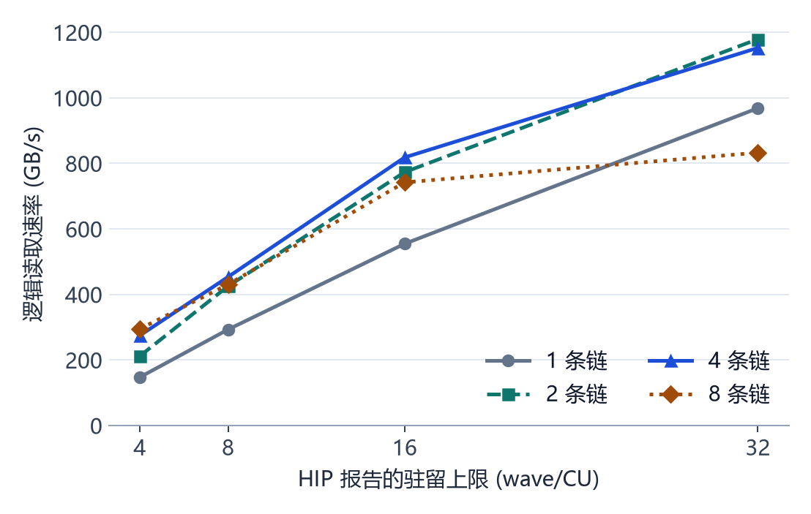

<script setup>
import MicroarchDiagram from "../.vitepress/theme/MicroarchDiagram.vue"
</script>

# 1.4 · 调度、Occupancy 与延迟隐藏

一个 wave 在等数据时，CU 还可以调度其他就绪的 wave。本章介绍 CU 能同时容纳多少工作，以及怎样用独立指令减少等待造成的空闲。

## 基础概念 · Occupancy 与资源约束

### 6.1 Occupancy 是什么？

Occupancy 用于衡量 GPU 上可驻留的 Wavefront 数量与硬件上限之间的关系。

例如某个 CU 最多可以驻留 40 个 Wavefront，而当前 Kernel 实际驻留 20 个：


$$\text{Occupancy} = 20 / 40 = 50\%$$


这是一个简化示例。

实际还需要区分：

- 理论 Occupancy。
- 实际驻留 Wave 数。
- 活跃执行比例。
- 执行单元利用率。

这些指标不能混为一谈。

### 6.2 为什么寄存器和 LDS 会影响 Occupancy？

一个 CU 能够同时驻留多少个 Block，受到多个资源限制。

可以近似理解为：


$$
N_{\text{Blocks}}
\leq
\min
\left(
N_{\text{LDS}},
N_{\text{VGPR}},
N_{\text{SGPR}},
N_{\text{Wave}},
N_{\text{BlockSlots}}
\right)
$$

实际资源分配是按**硬件分配粒度（Allocation Granularity）**进行的，而不是连续线性分配。VGPR、SGPR 或 LDS 的需求跨过分配粒度时，驻留上限可能跳到下一档。粒度和资源池大小取决于目标设备。Kernel 启动约束可能改变寄存器分配，需用对应 DTK 的编译输出和计时确认收益。

例如，在具有 64 KB LDS 的 CU 上：

- 一个 Block 使用 16 KB，LDS 容量最多支持 4 个这样的 Block。
- 一个 Block 使用 32 KB，最多支持 2 个。
- 一个 Block 使用 48 KB，最多支持 1 个。

这些只是 LDS 单项资源的上限。

如果寄存器或 Wavefront 数量先达到限制，实际驻留 Block 数可能更低。

### 6.3 为什么高 Occupancy 不一定更快？

假设一个 GEMM Kernel：

方案 A：

- 每个 Thread 使用较少寄存器。
- Occupancy 较高。
- 但是矩阵 Tile 小，数据重复加载较多。

方案 B：

- 每个 Thread 使用更多寄存器。
- Occupancy 较低。
- 但矩阵 Tile 更大，数据复用更好，MMAC 执行效率更高。

方案 B 仍然可能更快。

因此 Occupancy 只是资源与延迟隐藏能力的一个指标，不能直接代表最终性能。

### TLP 与 ILP

**TLP** 用其他就绪 wave 的工作覆盖一部分等待。**ILP** 用同一个 wave 中互相独立的指令覆盖一部分等待。数据实际返回需要多久、还有多少等待可以隐藏，要结合对应的访存路径和可发射工作来判断。[E06 延迟阶梯](../labs/lab08-memory-latency-ladder.md)

## 案例 · 从驻留到发射，再到完成

在向量加法的例子里，设备在有空位和资源时安排 Block。Block 的 wave 获得寄存器与执行状态，有共享数据时还需为 Block 预留 LDS。发出 A 和 B 的加载后，依赖两个结果的加法要等数据回来。写回完成后，Block 结束并释放资源。

<MicroarchDiagram kind="latency" />

| 先问什么 | 怎么回答 |
|---|---|
| 最多能驻留多少？ | 对给定 kernel 和启动配置，用资源约束和 HIP API 估算。影响因素有 VGPR、SGPR、LDS 和驻留槽位。 |
| 当前谁能发射？ | 看驻留 wave 的指令依赖、是否在等数据，以及相应发射资源是否可用。 |
| 最后跑多快？ | 看同一工作量的计时、吞吐和相关计数。小 grid 还可能无法填满设备。 |

## 用 E04 解释一个反例



E04 用动态 LDS 预留改变 HIP 报告的驻留上限，每线程访问相同数量的节点。上限是 **4 wave/CU** 时，8 条链把耗时从约 0.4560 ms 降到 0.2278 ms；上限是 **32 wave/CU** 时，2 条链最快。横轴是理论驻留上限。增加链数也会改变寄存器用量、循环次数和发射顺序，实验确认了收益随配置变化，单个因素的贡献仍需独立验证。[E04 方法与 PMC](../labs/lab04-occupancy-ilp.md)

::: details 复述题 · 为什么只看 occupancy 或 VGPR 容易判断错？

资源数字给出的是可驻留条件。举例来说，改变 tile 大小可能同时改变寄存器用量、数据复用、每个 wave 的独立工作和指令数，最终耗时取决于这些变化。用计时确认有无收益，再看证据解释变化。[E09 GEMM 消融](../labs/lab07-triton-gemm-vs-rocblas.md)

:::

[进入 1.5 · 三分钟白板复述](../01-overview/whiteboard-review.md)

## 进阶阅读

::: details 查看 GEMM 生命周期与指令流水

### 五、Kernel 从启动到执行完成的完整过程

下面把前面所有硬件组件串起来。

假设需要执行一个 GEMM Kernel。

#### 阶段一：CPU 发起 Kernel

CPU 通过 HIP Runtime 发起计算任务。

```text
CPU / HIP Runtime
       ↓
Kernel Launch
       ↓
GPU 命令处理
       ↓
创建 Grid / Workgroup 任务
```

GPU 并不需要每执行一个 Thread 都让 CPU 参与调度。

CPU 提交 Kernel 后，GPU 内部负责后续任务分配和执行。

#### 阶段二：Workgroup 分配到 CU

GPU 根据 CU 可用资源分配 Workgroup。

需要考虑：

- 可用 Wavefront 驻留槽位。
- VGPR 资源。
- SGPR 资源。
- LDS 容量。
- Workgroup 数量限制。

资源不足时，部分 Workgroup 需要等待。

#### 阶段三：Wavefront 建立执行上下文

一个 Workgroup 被拆分成多个 Wavefront。

硬件为其建立执行所需的寄存器和控制状态。

Wavefront 进入可调度状态后，调度器根据指令依赖及执行资源情况选择执行。

#### 阶段四：指令被分配到不同执行路径

例如一个 GEMM Kernel 可能依次涉及：

```text
SALU
  └── 地址和循环控制

VMEM
  └── 从全局内存加载矩阵数据

LDS
  └── 数据共享与复用

VALU
  └── 数据转换、重排、逐元素处理

MMAC
  └── 矩阵乘加计算

VMEM
  └── 写回输出
```

这些操作并不一定完全串行。

经过合理的 Kernel 设计，数据加载、矩阵计算和部分独立指令可以通过流水线方式重叠。

#### 阶段五：同步和结果写回

如果多个 Wavefront 需要共享数据，必须保证数据写入完成后，消费者才能读取。

例如：

```cpp
// 多个线程写入共享数据
shared_buf[threadIdx.x] = value;

__syncthreads();

// 同一个 Block 的线程读取共享数据
float x = shared_buf[other_idx];
```

对于更复杂的异步搬运及矩阵指令，还可能需要额外的等待与同步机制。

`__syncthreads()` 是 Block 级同步，并不是所有 GPU 或所有 Block 的全局同步。

#### 阶段六：释放资源

当 Block 完成后，其寄存器、LDS 和驻留上下文资源被释放。

GPU 可以继续调度等待执行的其他 Workgroup。

整个过程的关键在于：

**GPU 不仅需要计算单元足够快，还需要调度器不断提供可执行任务，访存系统及时提供数据，寄存器和 LDS 能够支持足够的数据复用与并行度。**

---

### 6.4 延迟隐藏与指令流水

假设 Wave 0 正在等待一次 HBM Load。

调度器可以在资源允许时执行其他 Wavefront。

这属于 Thread-level Parallelism（TLP）带来的延迟隐藏。

另外，一个 Wavefront 内部也可能存在多条彼此独立的指令，通过流水线执行形成 Instruction-level Parallelism（ILP）。

对于 GEMM 和 MMAC 优化，需要同时关注：

- 是否有足够的 Wavefront 隐藏访存延迟。
- 是否有足够独立的矩阵指令隐藏计算延迟。
- 数据加载能否提前进行。
- LDS 和寄存器是否提供充分的数据复用。
- 资源使用是否影响后续任务的驻留。

:::

## 进阶 · Roofline 与算子归因

### 6.5 Roofline 模型与 BW100 对照

计算强度 $I = F / B_\mathrm{HBM}$，其中 $F$ 是定义明确的运算量，$B_\mathrm{HBM}$ 是硬件边界的实际读写字节。理想上限为 $\min(P_\mathrm{compute}, I \cdot BW_\mathrm{HBM})$，拐点为 $P_\mathrm{compute} / BW_\mathrm{HBM}$。靠近哪条线用于提出瓶颈假设，再用资源与消融数据验证。

[BW100 基线](../baselines/bw100-gfx936.md) 可先提供两条经验参照：[E07](../labs/lab09-mmac-builtin-and-valu.md) 的 FP16 输入、FP32 累加 MMAC 微基准为 333.49 TFLOPS，[E01](../labs/lab01-memory-coalescing.md) 的向量拷贝有效带宽为 1.367 TB/s。按这两个工作负载约为 **244 FLOPs/B**；拷贝的逻辑字节数与实际 HBM 流量使用不同口径，244 只是经验位置。对 [E09](../labs/lab07-triton-gemm-vs-rocblas.md) 的 `4096³` GEMM，计入 A、B 各读一次和 C 写一次，约为 1365 FLOPs/逻辑字节。若要在同一张严格的 HBM Roofline 上定位，先测出每个 GEMM 配置的实际 HBM 读写字节。

### 6.6 VGPR 更少，为什么没有更快？

[E09](../labs/lab07-triton-gemm-vs-rocblas.md) 中，只把 `BK` 从 32 改为 16，VGPR 从 144 降到 112，LDS 仍为 8704 B，scratch 仍为 0，耗时却从 1.4120 ms 增至 1.4973 ms。诊断时先用最终 code object 的 VGPR、SGPR、LDS 及当前设备的分配粒度计算驻留上限，再看 K 循环次数和 ISA 是否变化，最后用计数器与计时交叉验证。[E04 的动态 LDS 对照](../labs/lab04-occupancy-ilp.md) 可用来观察单个资源约束如何改变驻留上限。
