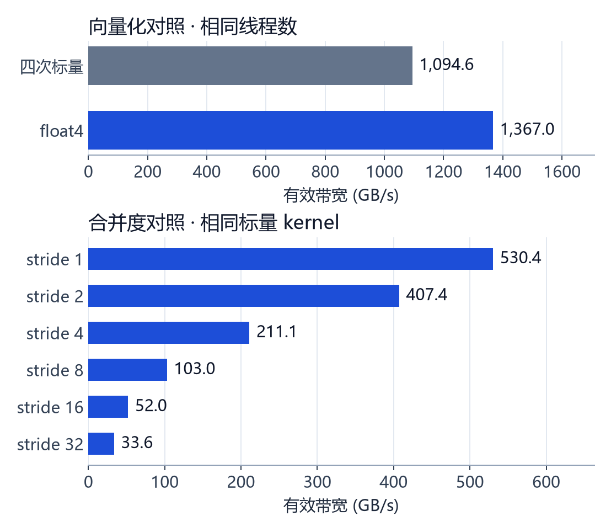

# E01 · 合并访存与向量化

**研究问题**　固定有效复制量和地址覆盖后，stride 与向量化各自会怎样影响 BW100 的拷贝性能？

在 BW100 上，`float4` 的有效拷贝带宽为 **1367.01 GB/s**，是同一 dispatch 规模下四次标量访问的 **1.25 倍**。独立的 stride 对照中，stride 从 1 增到 32，带宽从 530.35 降到 33.62 GB/s。各配置通过全缓冲区校验。

[适用环境](../baselines/bw100-gfx936.md) · [复现命令](#复现命令)

## BW100 结果



每组先预热，每轮测量 20 次 dispatch。图中为 5 轮的中位数，两组对照各用独立横轴。有效带宽按 `(256 MiB 读 + 256 MiB 写) / 耗时` 计算，单位为十进制 GB/s。

| 对照 | 配置 | 中位数 (GB/s) | 最小值–最大值 (GB/s) |
|---|---|---:|---:|
| 向量化 | 每线程四次标量读写 | 1094.63 | 1094.34–1094.82 |
| 向量化 | 每线程一次 `float4` 读写 | 1367.01 | 1364.66–1368.04 |
| 合并度 | stride 1 | 530.35 | 530.33–530.36 |
| 合并度 | stride 2 | 407.37 | 407.35–407.45 |
| 合并度 | stride 4 | 211.12 | 211.11–211.24 |
| 合并度 | stride 8 | 103.05 | 103.00–103.15 |
| 合并度 | stride 16 | 52.00 | 51.96–52.07 |
| 合并度 | stride 32 | 33.62 | 33.48–33.70 |

## 复现命令

在仓库根目录执行。根据目标卡设置 `--offload-arch`。

```bash
cd experiments
hipcc -O3 -std=c++17 --offload-arch=gfx936 -save-temps 02_coalescing_and_vec.hip -o 02_coalescing_and_vec
./02_coalescing_and_vec > e01.csv
```

[下载原始计时 CSV 与 ISA](/data/bw100-20261118.zip) · [存储体系原理](../03-memory/memory-hierarchy.md)

## 实验设计与口径

- **合并度对照**使用同一个标量 kernel。把线性线程号拆成二维坐标再转置：`offset = column * stride + row`。stride 为 2 的幂时可用位运算实现。每个元素恰好被读写一次。旧版取模映射会让偶数 stride 出现重复地址，这一版的数据替换了旧结果。
- **向量化对照**两组都启用 `N/4` 个线程，每线程复制四个 float。标量组分四段访问，每段内相邻 lane 连续。向量组以对齐的 16 字节访问复制相同总量。设备端 ISA 中可看到向量组的 `global_load_dwordx4` 和 `global_store_dwordx4`。
- 结果可用作这个 copy 工作负载的带宽参考。向量化对照与 stride 对照的每线程工作量不同，应在各自组内比较。若要估算实际 HBM 流量，还需核对对应设备计数器的定义与单位。

::: details 查看完整源码

<<< ../../experiments/02_coalescing_and_vec.hip{cpp}

:::
