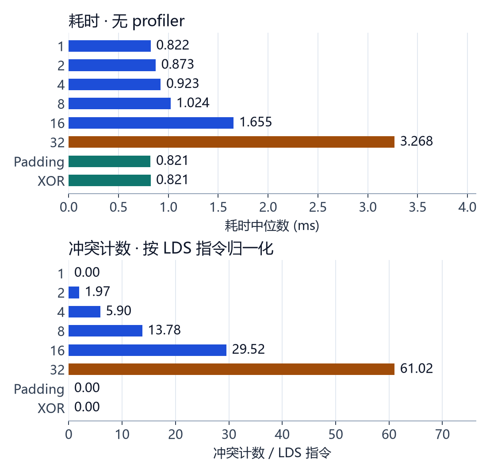

# E02 · LDS Bank Conflict 与 Padding / XOR Swizzle

**研究问题**　访问相同数量的 LDS 字时，增加同 bank 的不同地址数会怎样影响耗时？Padding 和 XOR 能消除多少冲突？

BW100 只读循环复测中，32 路布局耗时为 **3.268 ms**，是 1 路的 **3.97 倍**。Padding 和 XOR Swizzle 的冲突计数均为零，耗时回到约 **0.822 ms**。所有线程的累计和均通过校验。

[适用环境](../baselines/bw100-gfx936.md) · [复现命令](#复现命令)

## BW100 结果



图中的 1–32 表示按 32-bank 模型计算的**每 32 lane、每个使用的 bank 中的不同地址数**。编译出的 kernel 固定为每 block 256 线程、相同 LDS 分配，读取循环每线程执行 2048 次。计时为无 profiler 的五轮中位数，每轮测量 20 次 dispatch。PMC 单独采集，每个变体取六次目标 dispatch 的后五次。

| 地址布局 | 耗时中位数 (ms) | `SQ_LDS_BANK_CONFLICT` / `SQ_INSTS_LDS` |
|---|---:|---:|
| 1 路 | 0.8224 | 0.00 |
| 2 路 | 0.8728 | 1.97 |
| 4 路 | 0.9232 | 5.90 |
| 8 路 | 1.0242 | 13.78 |
| 16 路 | 1.6546 | 29.52 |
| 32 路 | 3.2678 | 61.02 |
| Padding，行跨度 33 | 0.8211 | 0.00 |
| XOR Swizzle | 0.8214 | 0.00 |

## 复现命令

在仓库根目录执行。单独运行二进制时，省略变体参数会测量全部布局。

```bash
cd experiments
hipcc -O3 -std=c++17 --offload-arch=gfx936 -save-temps 03_lds_bank_conflict.hip -o 03_lds_bank_conflict
./03_lds_bank_conflict > e02.csv
hipprof --pmc --pmc-type 3 --kernel-name lds_read_kernel -o e02-degree32-pmc \
  ./03_lds_bank_conflict degree32 profile
python3 parse_hipprof_pmc.py e02-degree32-pmc.csv --kernel lds_read_kernel --expect-dispatches 6
```

[下载逐轮计时、PMC 与 ISA](/data/bw100-lds-occupancy.zip) · [存储体系原理](../03-memory/memory-hierarchy.md)

## 如何解读

- 每组 32 lane 使用各自的 LDS 区域，在初始化后统一同步。循环中的地址映射保持一一对应，变体间改变同 bank 的地址分布。Padding 改变行跨度，XOR 用列号随 lane 变化来分散 bank。各组共用相同的分配大小，便于固定驻留资源。
- 本版 DCC 导出显示循环使用访问 shared aperture 的 `flat_load_dword`，循环中没有 LDS 写入。所有布局报告同样的 `SQ_INSTS_LDS=4,261,888`。图中的归一化计数来自整个 dispatch，含初始化。`61.02` 是 profiler 计数的比值，和横轴的 32-lane 模型使用不同单位。
- 旧版在循环里同时读写 LDS，不同 wave 可能访问同一位置。其 **19.62 倍**是旧程序的历史观测。评估只读工作负载时使用上表。[旧版实验记录](https://github.com/mantuoluozk/dcu-microarch-guide/blob/c9c4e6c/docs/labs/lab02-lds-bank-conflict.md)

::: details 查看完整源码

<<< ../../experiments/03_lds_bank_conflict.hip{cpp}

:::
