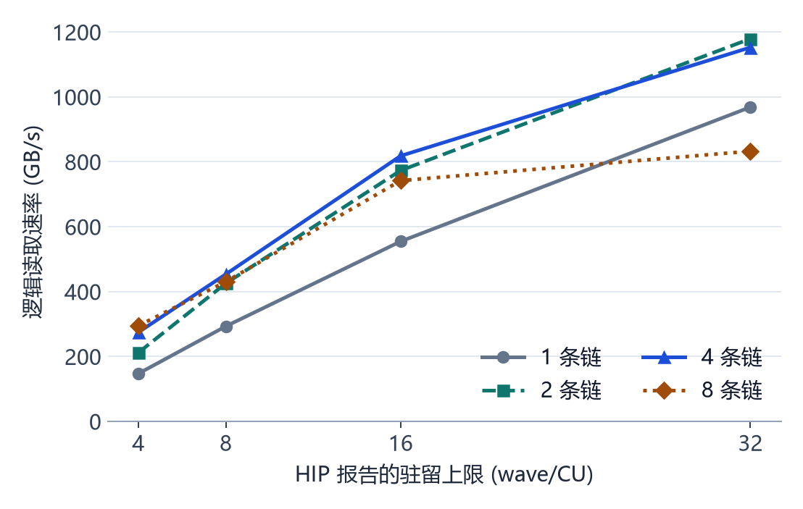

# E04 · Occupancy 与独立加载链

**研究问题**　固定每线程读取量时，增加独立加载链能在多大程度上补偿较低的 wave 驻留上限？

在 BW100 上，**4 wave/CU 上限时**，8 条链使耗时从 0.4560 ms 降到 **0.2278 ms**。**32 wave/CU 上限时**，最快的是 2 条链（0.0569 ms），8 条链耗时增加到 0.0806 ms。独立链数量的收益随驻留条件变化。

[适用环境](../baselines/bw100-gfx936.md) · [复现命令](#复现命令)

## BW100 结果



图中的读取速率按每次 dispatch 的 **64 MiB 逻辑输入量 / 耗时**计算。横轴来自 HIP occupancy API，表示给定资源与启动配置下的驻留上限。表中为无 profiler 的五轮耗时中位数，每轮测量 20 次 dispatch。16 个配置均通过全量回环校验。

| 动态 LDS / block | 驻留上限 (wave/CU) | 1 条链 (ms) | 2 条链 (ms) | 4 条链 (ms) | 8 条链 (ms) |
|---|---:|---:|---:|---:|---:|
| 0 KiB | 32 | 0.0693 | **0.0569** | 0.0582 | 0.0806 |
| 16 KiB | 16 | 0.1210 | 0.0868 | **0.0820** | 0.0904 |
| 32 KiB | 8 | 0.2291 | 0.1578 | **0.1480** | 0.1559 |
| 48 KiB | 4 | 0.4560 | 0.3170 | 0.2446 | **0.2278** |

## 复现命令

```bash
cd experiments
hipcc -O3 -std=c++17 --offload-arch=gfx936 -save-temps 05_occupancy_and_ilp.hip -o 05_occupancy_and_ilp
./05_occupancy_and_ilp > e04.csv
hipprof --pmc --pmc-type 3 --kernel-name chase_rings -o e04-8-48-pmc \
  ./05_occupancy_and_ilp 8 48 profile
python3 parse_hipprof_pmc.py e04-8-48-pmc.csv --kernel chase_rings --expect-dispatches 6
```

[下载逐轮计时、PMC 与 ISA](/data/bw100-lds-occupancy.zip) · [Occupancy 与 Roofline](../04-scheduling/occupancy-and-roofline.md)

## 如何解读

- 每个线程访问同一组 64 个节点。把这些节点拆成 1、2、4 或 8 条环，链内的下一次地址依赖上一次加载结果。初始化和正确性校验在计时之外。所有链数都以加载器返回的索引寻址，循环中无需额外取模。
- 动态 LDS 仅在 kernel 启动时预留，循环中无 LDS 读取。独立 PMC 采集核对了 `0/16384/32768/49152 B` 的实际预留字段。每组 HIP 驻留上限为 32、16、8、4 wave/CU。图中的速率按逻辑读取量折算，实际驻留与物理流量需另测。
- ISA 中各特化的循环体分别包含 1、2、4 和 8 条 `global_load_dword`。增加链数也改变循环次数、地址发射顺序和 VGPR 用量，PMC 的 `arch_vgpr` 分别为 8、12、16、28。这里测得的是完整实现的延迟隐藏收益，较高驻留上限时 8 条链变慢的具体原因仍需独立对照。
- 旧版会在 0 KiB 档位尝试读取动态 LDS，并且两种 ILP 写法有不同索引成本。新版移除了该读取，并让不同链数访问相同节点集合。[旧版实验记录](https://github.com/mantuoluozk/dcu-microarch-guide/blob/c9c4e6c/docs/labs/lab04-occupancy-ilp.md)

::: details 查看完整源码

<<< ../../experiments/05_occupancy_and_ilp.hip{cpp}

:::
