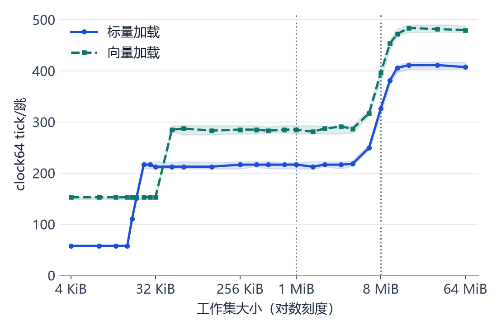
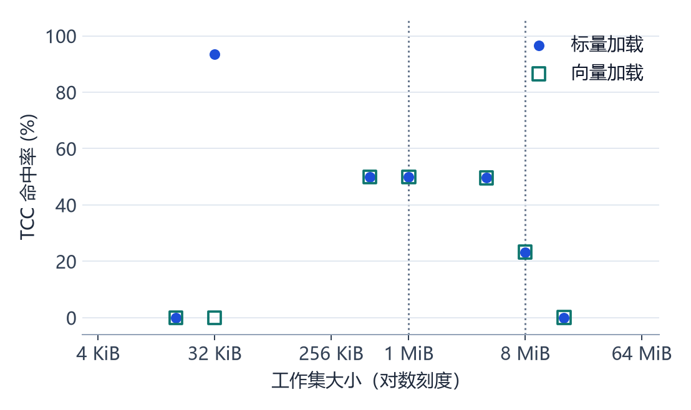

# E06 · 存储延迟阶梯

**研究问题**　走完整个随机依赖链后，标量和向量加载分别在哪些工作集范围内出现延迟转折？

BW100 上复测**未见旧版的 1 MiB 台阶**。64 B 节点间距下，标量路径在 16–24 KiB 转折，向量路径在 32–48 KiB 转折。两条路径在更大的工作集持续上升，8–16 MiB 间 TCC 命中率明显下滑。

[适用环境](../baselines/bw100-gfx936.md) · [复现命令](#复现命令)

## BW100 结果



64 B 节点间距。各点为三个 seed 各跑五次得到的 15 个样本的中位数，阴影为最小值到最大值。两条竖虚线分别标记旧版报告台阶的位置 **1 MiB**、运行时报告的 L2 容量 **8 MiB**。横轴按对数刻度展示完整扫点，下表保留代表性尺寸和精确图值。

| 工作集 | 标量路径 | 向量路径 |
|---|---:|---:|
| 16 KiB | 57.6 | 152.5 |
| 24 KiB | 216.5 | 152.5 |
| 32 KiB | 212.4 | 152.5 |
| 48 KiB | 212.5 | 284.8 |
| 1 MiB | 216.5 | 284.9 |
| 8 MiB | 326.5 | 396.4 |
| 16 MiB | 411.0 | 483.6 |

### TCC 计数器对照



只标出实际采集 PMC 的尺寸。每个点取五次目标 dispatch 的 TCC 命中计数总和除以命中与未命中计数总和，**包含预热和计时两段**。16 KiB 时每个 dispatch 仅报告约 278 次命中加未命中计数，到了 1 MiB 约为 32800 次。小工作集的低 TCC 命中率需要结合到达 TCC 的计数规模解读。

## 复现命令

```bash
cd experiments
hipcc -O3 -std=c++17 --offload-arch=gfx936 -save-temps   07_memory_latency_ladder.hip -o 07_memory_latency_ladder
./07_memory_latency_ladder 0 42 64 scalar > e06-scalar.csv
./07_memory_latency_ladder 0 42 64 lane > e06-lane.csv
hipprof --pmc --pmc-type 3 --kernel-name global_chase_kernel -o e06-lane-8192   ./07_memory_latency_ladder 8192 42 64 lane
python3 parse_hipprof_pmc.py e06-lane-8192.csv --kernel global_chase_kernel --expect-dispatches 5
```

[下载完整扫点、计数器 CSV 与 ISA](/data/bw100-20261118.zip) · [存储体系原理](../03-memory/memory-hierarchy.md)

## 如何解读

- 每个随机环以单线程执行，预热和计时各访问整数圈，且至少 4096 跳。用等待指令确保依赖链最后一次读取完成，再读时间戳。标量版从常量零起步，向量版从 lane 索引起步。单线程运行时两者都从零开始，ISA 分别发出 `s_load_dword` 和 `global_load_dword`。
- 64 B 间距下，两条路径的 TCC 命中率在 512 KiB、1 MiB、4 MiB 均约为 50%，在 8 MiB 降至约 23%，在 16 MiB 降至约 0.05%。PMC 覆盖整个 dispatch，包含预热与计时两段。1 MiB 的台阶假设缺乏这次复测支持。较大工作集上的趋势支持缓存复用下降，也可能混有地址转换和替换行为。
- 32 B 和 128 B 间距改变了地址覆盖密度，转折也随之变化。例如标量路径在 128 B 间距下，32 KiB 仍约为 58 tick。表中的工作集大小是分配范围，精确 cache 容量和 line 大小仍需独立实验。
- 容器内 DTK 26.04 HIP 头文件将 `clock64()` 定义为 GPU core cycle count，导出的 ISA 使用 `s_memtime`。运行时频率会变化，本实验报告 tick，绝对纳秒需要独立频率校准。计时包含依赖链的地址计算和循环开销。

::: details 查看完整源码

<<< ../../experiments/07_memory_latency_ladder.hip{cpp}

:::
